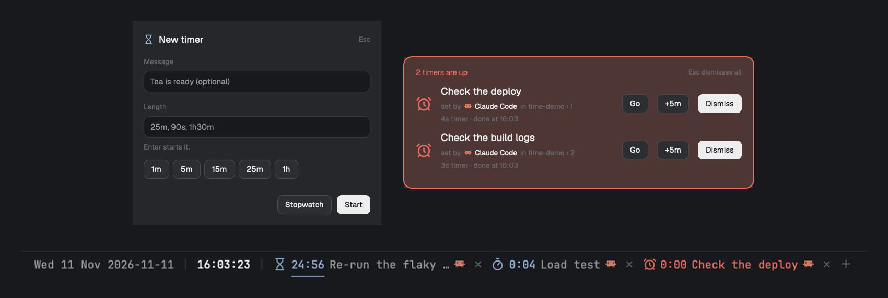
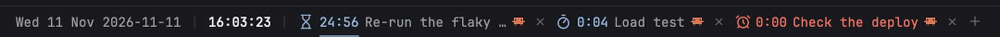
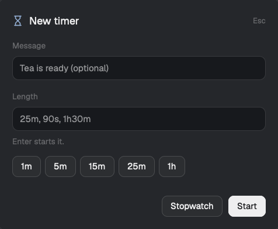
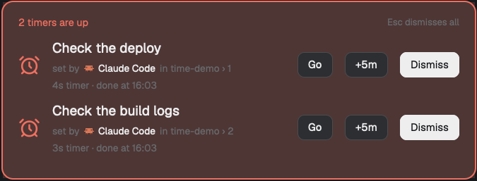

# herdr-time

A Herdr desktop app mod for the status bar: the date and time in any format you like (the clock stays pinned at the right end of its block), plus reminders (once or repeating), countdowns and stopwatches with messages. A reminder that rings flashes a banner until you dismiss or snooze it.

> The images below are from the earlier timers-only version and are stale; they have not been retaken.



## Install

Ask your agent: `Read ~/.config/herdr-app/AGENTS.md, then add this mod: herdr.dev/mods/ryanthedev/herdr-time`

Or by hand: `scripts/install.sh` copies `mods/time` (every `*.js` file and its icons) into `~/.config/herdr-app/mods/time` and runs `herdr-app check`. Then place it in your layout (below). [RECIPE.md](RECIPE.md) is the full brief for rebuilding it.

- `mods/time/`: the mod (`main.js`, `schedule.js` for the pure time logic, `mod.json`, `icons/`).
- `test/`: `node --test test/` checks the time logic.
- `scripts/demo-setup.sh`, `scripts/fake-agent.sh`: a throwaway demo space for screenshots in an isolated window.

## Reminders and timers



- **Bar order:** chips for what is running or ringing and the next reminder, a bell with the count (click for the full list), `+`, a `|`, then the clock last.
- **Add:** click `+` for the New reminder dialog, with three kinds: **In** (a countdown: `25m`, `90s`, `1h30m`, a number of minutes, or a preset), **At a time** (`15:00`, `9:30`, `3pm`) and **Stopwatch**. A message is optional.
- **Repeat:** an **In** reminder can keep repeating every that length (at least 1m); an **At a time** one can repeat every day or on weekdays. The dialog shows in words when it will ring first.
- **The list:** the bell opens every reminder and timer, soonest first, each with its next time, repeat rule, who set it, and Pause / Dismiss / remove. The bar only shows the next reminder, so standing ones don't widen it.
- **Pause / resume:** click a timer. **Remove:** its `×` (on a repeating reminder this ends the series).
- **Old timers:** timers saved by earlier versions still show and run.
- **Icons move:** a running stopwatch's hand sweeps, a running countdown's hourglass breathes and a line under it drains, a paused timer pulses slowly, a ringing one shakes.
- **Left ringing:** a repeating reminder you don't dismiss rings again when its next time comes. A repeat dismissed less than half an interval before its next time waits a full interval.
- **The red border:** while anything rings, the terminal pane's focus border turns red (the layout's `pane.focus.color`, set with `layout.set`), and goes back the moment nothing rings. The colour it replaced is kept in shared `time.look`, so a restart while red restores it. The card opens small in the window's bottom-left corner above the status bar and never takes the keyboard (buttons only, no Esc). The window's outer frame is Herdr's and can't be changed.
- **When one rings:** it turns red in the bar, a Herdr notification is posted, a chime plays (macOS), and a banner flashes in the middle of the window with every ringing item and who set it. Each row has **Dismiss** (**Done** for a repeating reminder, which then moves to its next time), **+5m** (snooze; the series is kept) and **Go** for an agent's; Esc dismisses them all.
- **Kept:** items live in Herdr's shared state (`time.timers`), so they survive reloads and restarts. One that came due while Herdr was closed rings once on start; a repeating one then skips to its next future time.

 

## Reminders set by agents

You set reminders in the dialog. Anything else, such as an agent running `herdr-app do`, has to say which agent is asking and what the timer is for:

```sh
herdr-app do "time.timer-25m @$HC_TERMINAL_ID Check the deploy"
herdr-app do "time.at-15:00 @$HC_TERMINAL_ID Standup"
herdr-app do "time.every-30m @$HC_TERMINAL_ID Stretch"
herdr-app do "time.daily-09:00 @$HC_TERMINAL_ID Plan the day"
herdr-app do "time.weekdays-17:30 @$HC_TERMINAL_ID Write the log"
herdr-app do "time.stopwatch @$HC_TERMINAL_ID Load test"
```

- **`@$HC_TERMINAL_ID`** is the agent's own terminal (herdr-core sets it in every terminal). It must be a live agent, so the mod can look up its name, space and tab.
- **The message is required.** No blank alarms.
- **Refused otherwise:** a command without both, with an unknown terminal, or with a bad length or time starts nothing and posts a "Reminder refused" notification saying why.
- **Shown everywhere:** the agent's icon sits next to its reminder in the bar, the tooltip says "set by Claude Code in herdr-time › 1", the banner has a "set by" line and a **Go** button that jumps to the agent, and the "Reminder" / "Time's up" notification names it (clicking it jumps there too).
- **Limits:** a command can't prove who sent it, so an agent could name another agent's terminal. `herdr-app do` answers `ok` either way, so an agent doesn't see a refusal; the person does.

Commands, for `herdr-app do time.<command>` or `keys.json` (`"alt-t": "time:new"`):

| Command | Does |
|---|---|
| `new` | open the New reminder dialog |
| `list` | open the list of reminders and timers |
| `stopwatch @<terminal> <message>` | start a stopwatch for that agent |
| `timer-<length> @<terminal> <message>` | start a countdown for that agent, e.g. `timer-25m @t12p Check the deploy`, `timer-90s`, `timer-1h30m` |
| `at-<time> @<terminal> <message>` | ring once at the next `15:00`, `9:30` or `3pm` |
| `every-<length> @<terminal> <message>` | ring every length (1m or more), e.g. `every-30m` |
| `daily-<time> @<terminal> <message>` | ring every day at that time |
| `weekdays-<time> @<terminal> <message>` | ring Monday to Friday at that time |
| `toggle` | pause or resume the newest timer |
| `pause-all` / `resume-all` | pause or resume every timer |
| `dismiss` | dismiss everything ringing (repeating ones move to their next time) |
| `clear` | remove every reminder and timer |

## Format

Set in the layout block's props (all optional):

```json
{ "id": "time", "type": "block",
  "content": { "mod": "time", "props": {
    "format":  "%a %-d %b %Y | [%H:%M:%S]",
    "tooltip": "%A %-d %B %Y · week %V · day %j · UTC%z",
    "presets": [1, 5, 15, 25, 60],
    "font":    "BerkeleyMono Nerd Font",
    "block":   "time" } } }
```

- **Tokens** (strftime style): `%a` Wed, `%A` Wednesday, `%b` Nov, `%B` November, `%d` day, `%e` space-padded day, `%m` month, `%y` 26, `%Y` 2026, `%H` 00-23, `%I` 01-12, `%p` AM/PM, `%M` minutes, `%S` seconds, `%s` Unix seconds, `%j` day of year, `%V` ISO week, `%u` weekday 1-7, `%w` weekday 0-6, `%z` UTC offset, `%%` a percent sign. `%-d`, `%-m`, `%-H`, `%-I`, `%-j`, `%-V` drop the leading zero.
- **`|`** draws a dim separator. **`[...]`** draws its text bright; the rest is muted.
- **`presets`** are the countdown lengths (minutes) the dialog offers.
- **`font`** is the font family. Left out, it uses your terminals' font (monospaced), so digits keep their width and the bar doesn't shift each second. `""` uses the app's UI font.
- **`block`** is this block's layout id. The mod resizes it to fit as things come and go.
- **`fill`** (`true`) makes the block take the layout's size (give it a weight; it is never resized). The clock is centered in it and the chips, bell and `+` sit to its right.

## Placing it

`mod.json` uses `"place": "none"`, so the layout decides where it shows. Wrap your layout's bottom `status` block in a row with this block beside it (first or last; the clock sits at the right of the block):

```json
{ "id": "status-bar", "type": "row", "size": { "px": 28 }, "resizable": false,
  "children": [ <the time block above>, { "id": "status", "type": "block", "content": { "mod": "workspace-status" } } ] }
```

Apply a changed layout with `herdr-app do layout.set '{"layout": <whole layout json>}'`.

Icons in `mods/time/icons` follow [Lucide](https://lucide.dev) (ISC).
