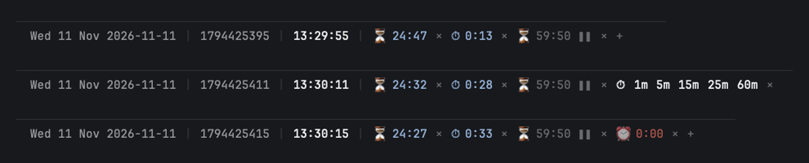

# Time

A clock and timers at the left end of the status bar. The date, Unix seconds and the time tick every second in any strftime-style format, and beside them sit stopwatches and countdowns you start from a + picker and pause, resume or remove with a click.



## What you see

One 28px strip, left to right, drawn by one mod (`time`) in a block placed just before the existing status bar mod:

- **Clock**: `Wed 11 Nov 2026-11-11 | 1794425395 | 13:29:55` by default. Text is 11.8px in the terminals' font (monospaced, so digits never change width and nothing shifts each second). Plain text is the theme's `muted` color, `[bracketed]` parts are `foreground`, and `|` is a separator in the `border` color. Hover: `Wednesday 11 November 2026 · week 46 · day 315 · UTC-0600`.
- **A `|` separator**, then each **timer**: an icon and its time, then a dim `×`.
  - Stopwatch: ⏱ counting up, `accent` color.
  - Countdown: ⏳ counting down (rounded up, so 0:00 only shows when done), `accent` color.
  - Paused: `dim` color with ` ❚❚` after the time.
  - Finished: ⏰ `0:00` in the `blocked` color, pulsing opacity 0.35 to 1 every 900ms.
  - Times read `m:ss`, or `h:mm:ss` from an hour.
- **`+`** in `dim`. Clicked, it becomes the picker: ⏱ (stopwatch), then `1m 5m 15m 25m 60m` (countdowns), then `×` to close.
- **Ground**: the theme background at the layout's terminal opacity, with a 1px top border, the same as the shipped `workspace-status` bar, so the two blocks read as one bar.

## How it behaves

- **Click a timer**: pause or resume it. Click a finished one: dismiss it.
- **Click `×`**: remove that timer.
- **Click a picker entry**: start that timer and close the picker.
- **A countdown reaching zero**: marked finished, a Herdr notification "Timer done · 25m timer finished" (level success), and on macOS `afplay /System/Library/Sounds/Glass.aiff`.
- **Width**: the mod resizes its own layout block (`layout.resize`) whenever its content's estimated width changes by 4px or more, so it never clips and never leaves a gap.
- **Key commands** via `nextCommand()` (`"alt-t": "time:timer-25m"` in keys.json, or `herdr-app do time.<command>`): `stopwatch`, `timer-<n>s|m|h` (decimals allowed), `toggle` (pause/resume the newest unfinished timer), `pause-all`, `resume-all`, `clear`, `pick`.
- Agent statuses: not used.

## Built from

- **Layout**: the status block is wrapped in a row so the clock sits to its left:
  ```json
  { "id": "status-bar", "type": "row", "size": { "px": 28 }, "resizable": false, "children": [
    { "id": "time", "type": "block", "size": { "px": 330 }, "content": { "mod": "time", "props": { "block": "time" } } },
    { "id": "status", "type": "block", "content": { "mod": "workspace-status" } } ] }
  ```
  No `divider` and no `gap` on the row: either shows a seam.
- **`mods/time/mod.json`**: `{ "place": "none", "title": "Time" }`. Placement comes only from the layout.
- **Props** (all optional): `format` (template, default `%a %-d %b %Y-%m-%d | %s | [%H:%M:%S]`), `tooltip` (template), `presets` (countdown minutes), `font` (family; default `settings().font_family`, `""` for the UI font), `block` (its layout id, default `time`).
- **Tokens**, formatted by hand from `Date` (no `Intl`): `%a %A %b %B %d %e %m %y %Y %H %I %p %M %S %s %j %V %u %w %z %%`; `%-x` drops the leading zero. `%V` is the ISO 8601 week, `%z` comes from `getTimezoneOffset()`.
- **State**: shared `time.timers`, a list of `{ id, kind: "up" | "down", ms, acc, at, rang }`. Time run = `acc + (now - at)` while running; pausing folds it into `acc` and sets `at` to null. Shared state persists, so timers survive reloads.
- **herdr**: `theme`, `layout`, `props`, `settings`, `shared`, `setShared`, `nextCommand`, `notify`, `exec`, `run("layout.resize")`, `window`.
- **gpui-kit**: `div`, `h_flex`, `.font_family`, `.tooltip`, `.on_click((e, cx) => …)`, `.loop("opacity", …)`.
- **Programs**: `afplay` (macOS only) for the finish sound. No network, no files outside its folder.

## Watch out

- `settings()` names the terminal font `font_family`, not `font` (settings.json's `font`). Reading `font` gets nothing and the bar falls back to the proportional UI font, where the digits jiggle every second.
- A click handler must call `cx.notify()` when it only changes the view's own fields; `setShared` re-renders by itself.
- Emoji are about 15px wide at this size against about 7.2px for a monospaced character; the width estimate counts them apart or the picker clips.
- A 1-second timer keeps running while the block is hidden; it only redraws when the shown text changes.
- `"place": "none"` means the mod never starts until a layout block names it.

## Done when

- `herdr-app check mods/time` passes and `herdr-app status` lists no errors.
- The clock matches `date "+%a %-d %b %Y-%m-%d | %s | %H:%M:%S"` and the seconds advance without anything to the right moving.
- `herdr-app do time.stopwatch` adds a ⏱ that counts up; `time.toggle` dims it with ❚❚; again resumes it.
- `herdr-app do time.timer-3s` turns into a pulsing red ⏰ 0:00 after 3 seconds, with a notification and a sound.
- `time.pick` shows the picker and the block widens to fit it; `time.clear` removes every timer and the block narrows.
